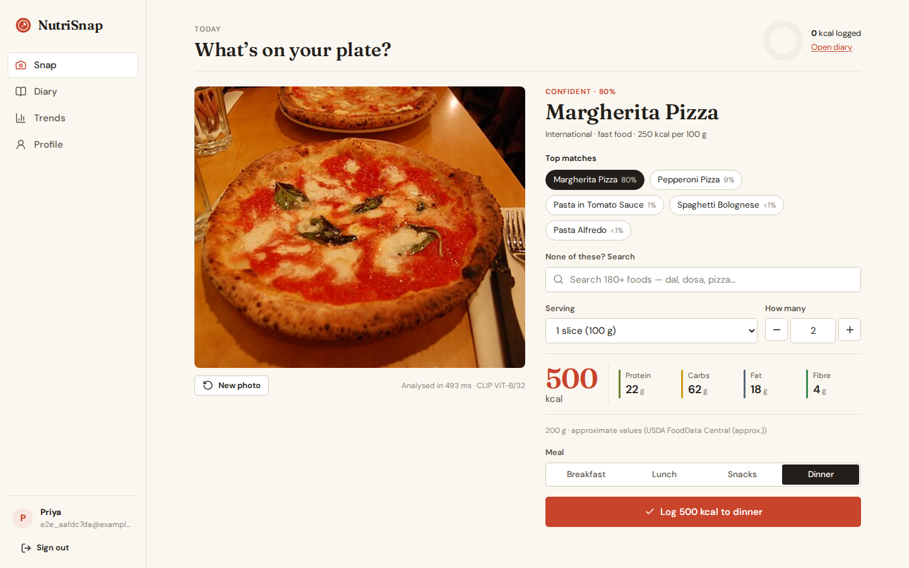
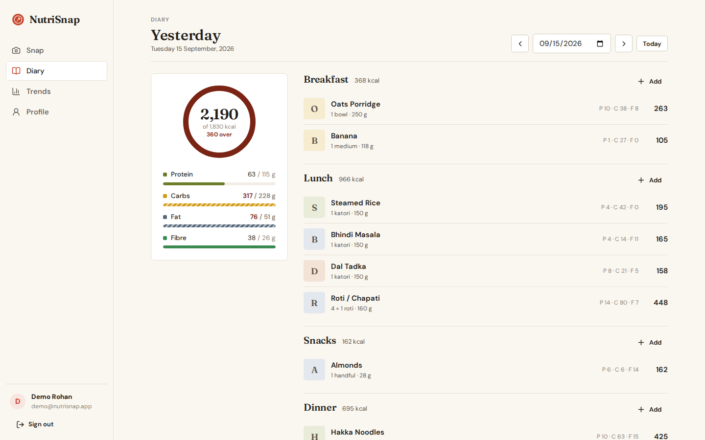
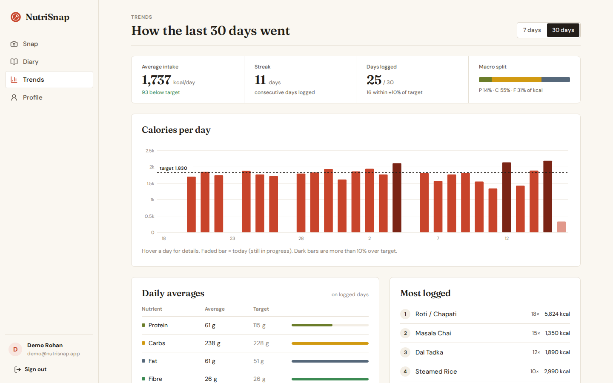
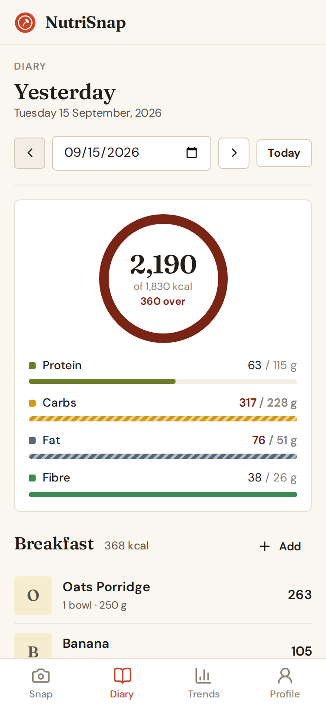
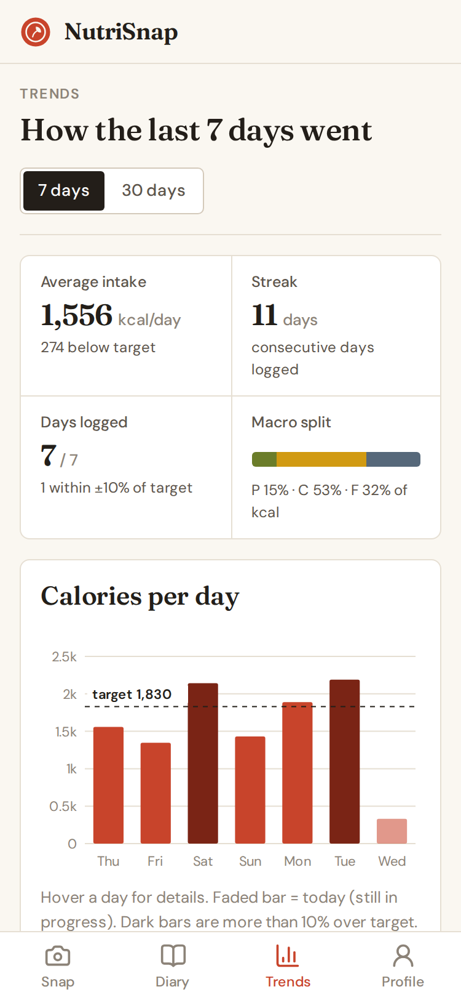

# NutriSnap

Take a photo of your plate. NutriSnap guesses the dish, you confirm it and pick a portion, and it logs the calories and macros. The food list is built for Indian meals first: 188 foods, 113 of them Indian (roti, dal, dosa, biryani, vada pav…), plus common international food.

**Stack:** React (Vite, TypeScript) · FastAPI · MongoDB · CLIP ViT-B/32 (quantized ONNX, runs on the CPU with onnxruntime, no PyTorch)

| Snap | Diary | Trends |
|---|---|---|
|  |  |  |
|  |  |  |

## Features

- **Snap & log.** Add a photo by upload, phone camera (`<input capture="environment">`), webcam or drag-and-drop. The top guess is selected for you and 4 other guesses appear as chips. If none of them is right, you can search the whole food list. Each food has its own serving sizes (1 roti, 1 katori, 1 plate, grams). Calories, protein, carbs, fat and fibre update as you change the portion. The meal type (breakfast, lunch, snacks, dinner) is suggested from the time of day.
- **Food recognition.** Zero-shot CLIP with prompt ensembling. It also has a "not food" check, a hint when the photo seems to hold more than one dish, and personalisation per user (a kNN over the photos that user has corrected).
- **Nutrition database.** 188 foods with values per 100 g and named serving weights. Values are approximate, from IFCT 2017 and USDA FoodData Central. They are stored in MongoDB with a weighted text index, and search also matches the start of a name or alias ("pane" finds paneer, "golgappa" finds pani puri).
- **Diary.** Meals are grouped by meal type. You can move between dates, edit or delete an entry, and see a calorie ring and macro bars against your targets.
- **Goals.** From your profile, NutriSnap works out BMR with the Mifflin–St Jeor formula, then TDEE, a calorie target and a macro split. The formula is shown with your own numbers filled in.
- **Trends.** 7- or 30-day calories against target, macro averages, macro split, calories by meal type, your most-logged foods and your streak. All of it comes from one MongoDB `$facet` aggregation.
- **Demo account:** `demo@nutrisnap.app` / `demo1234`, with 30 days of meals (there is a "Use demo account" link on the sign-in page).

## Architecture

```
 React (Vite)  ──/api──►  FastAPI  ──Motor──►  MongoDB
  Snap/Diary/              │                   users (+profile), foods (text index),
  Trends/Profile           │                   meals, photos (TTL), corrections
                           ▼
                 services/clip.py  (loaded once at startup)
                 ├─ vision_model_quantized.onnx   ← runs for every photo (~65 ms)
                 ├─ label matrix  188 × 512        ← built once from the text model, cached as .npy
                 └─ non-food matrix  11 × 512
                 services/personalize.py  (per-user kNN over corrected embeddings)
                 services/nutrition.py    (portions, Mifflin–St Jeor, macro split)
```

```
backend/
  app/        main.py (lifespan: indexes, food seeding, model load) · auth · foods · recognize
              meals · profile · trends · errors (consistent error JSON) · schemas
              services/ clip.py · personalize.py · nutrition.py
  data/foods.json            curated nutrition database
  scripts/download_models.py fetches the ONNX files from Hugging Face
  scripts/seed.py            food list + demo user with 30 days of meals
  ml/fetch_testset.py        re-downloads the evaluation images (from manifest.json)
  ml/evaluate.py             writes ml/metrics.json
  ml/testset/manifest.json   88 Wikimedia Commons images: URL, author, license
  tests/                     31 pytest tests (API with real Mongo, ML units, recognition)
frontend/src/  pages/ (Snap, Diary, Trends, Profile, Auth) · components/ · lib/
e2e/           test_e2e.py (Playwright) · run_e2e.sh
```

## How the ML works

1. **Preprocessing** (standard CLIP): EXIF rotation is fixed, the shortest side is resized to 224 px (bicubic), the image is centre-cropped to 224×224, scaled to 0–1 and normalised with CLIP's mean and std. The result is a float32 NCHW array, the `pixel_values` input. The vision model returns a 512-d `image_embeds` vector, which is then L2-normalised.
2. **Labels.** Each food is written out as prompts, such as `"a photo of {name}, a type of food."` and `"a close-up photo of {description}."`. There are 7 templates, using both the plain name and a visual description ("idli, soft white steamed rice cakes"). The text model runs **one prompt at a time**: this ONNX export pools at the EOS token and takes no attention mask, so padded batches would give wrong embeddings. The embeddings for each food are averaged and re-normalised (**prompt ensembling**). The resulting 188×512 matrix is cached in `models/cache/labels_ens_<hash>.npy`. The hash covers the food list, the templates and the model file, so editing `foods.json` rebuilds the cache (about 12 s). After that, each request only runs the vision model.
3. **Scoring.** `logits = 100 × cosine(image, labels)`, then softmax, then the top 5.
4. **"Not food" check.** The photo is also compared with 11 non-food prompts (person, room, screenshot, document, car…). The best food logit and the best non-food logit go through a 2-way softmax, and if food scores below 0.5 the UI shows a warning. You can still log the photo.
5. **Several dishes in one photo.** The model also runs on 5 crops (a 2×2 grid plus the centre). If a crop is confidently (≥ 45%) a different food from the whole-photo guess, the UI says "parts of the photo also look like …". This is only a hint: CLIP is a classifier, not a detector.
6. **Personalisation.** When you save a photo under a food other than the top guess, the backend stores `(image embedding, chosen food)` in `corrections`. On your next photo it finds the k=5 nearest corrected photos (cosine ≥ 0.72) and blends their votes in: `p = (1−α)·p_zeroshot + α·p_knn`. α grows from 0 at a similarity of 0.72 to 0.7 at 0.90. A near-duplicate of a photo you corrected therefore flips the ranking, while an unrelated photo is left alone. Each user's memory is separate. The Profile page lists what the app has learned from you.

### Evaluation (numbers written by `python -m ml.evaluate` to `backend/ml/metrics.json`)

The test set has 79 food photos across 20 dishes (15 Indian, 5 international) plus 9 non-food images. All come from Wikimedia Commons: I picked them by hand from category listings and skipped images that didn't clearly show the dish. The model chooses among **all 188 foods**. Where a Commons category is broader than one database entry, the image's accepted labels cover all the matching entries (for example, a "Biryani" photo counts as correct for chicken, mutton or veg biryani).

| Config | Top-1 | Top-5 |
|---|---|---|
| Single prompt (`a photo of {name}, a type of food.`) | 36.7% | 51.9% |
| **Prompt ensemble (7 templates, used in the app)** | **50.6%** | **75.9%** |
| Ensemble + simulated personalisation* | 68.4% | 93.7% |

- The ensemble got every image right for burger, pizza, fries, pani puri and dhokla. It got **none right** for dosa (read as paratha), idli, poha (read as veg biryani), vada pav (read as sandwich) and butter chicken (read as paneer butter masala). CLIP has seen far less Indian food than Western food, and the recognition misses are mostly between dishes that look alike. This is why the app always shows alternatives and a search box.
- The not-food check flagged 7 of 9 non-food images and 0 of 79 food images.
- Vision inference takes about 64 ms per image (median, 2 CPU threads). A full request with the multi-dish crops takes about 1 s.
- \*The personalisation run is leave-one-out: for each image, the kNN memory holds the *other* test photos that zero-shot got wrong, with their true labels. This is optimistic, because some Commons categories contain several photos of the same plate. Treat it as evidence that the mechanism works, not as a real-world accuracy figure.
- I did not tune the prompts on this test set. The templates were written before the evaluation was run.

## API

All routes except auth and foods need `Authorization: Bearer <token>`. Every error comes back as `{"detail": ..., "code": ...}`.

| Method | Path | Purpose |
|---|---|---|
| POST | `/api/auth/register`, `/api/auth/login` | Create an account or sign in; returns a JWT |
| GET | `/api/auth/me` | Current user (includes `has_profile`) |
| GET | `/api/foods?q=&limit=&skip=` | Search foods (prefix/alias match plus `$text` score) |
| GET | `/api/foods/{id}` | One food with its servings |
| POST | `/api/recognize?multi=&hour=` | Multipart `image` (≤ 8 MB, JPEG/PNG/WebP). Returns top-5 candidates, the not-food flag, other dishes seen, whether personalisation was applied, and a `photo_id` |
| GET | `/api/recognize/status` | Whether the model is loaded |
| GET | `/api/photos/{id}` | The user's own thumbnail |
| GET | `/api/corrections` | What personalisation has learned (aggregation) |
| POST | `/api/meals` | Log a food with `serving_label`, `quantity` and an optional `photo_id`; nutrients are computed on the server |
| GET | `/api/meals?date=YYYY-MM-DD` | One day's meals grouped by type, with totals (aggregation) |
| GET | `/api/meals/history?limit=&before=` | Cursor-paginated history |
| PATCH / DELETE | `/api/meals/{id}` | Edit portion, food, meal type or date / delete |
| GET / PUT | `/api/profile` | Profile plus computed targets and the formula breakdown |
| POST | `/api/profile/estimate` | Targets for the live form preview (nothing saved) |
| GET | `/api/trends?days=7..90&end=YYYY-MM-DD` | Daily series, averages, streak, top foods (`$facet`) |

Indexes: unique `users.email`; a weighted text index on `foods`; `meals (user_id, date, created_at)` and `(user_id, created_at)`; a TTL index on `photos.expires_at`, so photos never attached to a meal are deleted after 24 h; `corrections (user_id, photo_id)` unique.

## Setup on Windows

You need Python 3.11+, Node 20+ and MongoDB Community Server running on `localhost:27017`.

```powershell
# 1. backend
cd nutrisnap\backend
python -m venv .venv
.venv\Scripts\activate
pip install -r requirements-dev.txt
copy .env.example .env            # then set JWT_SECRET to a long random string
python -m scripts.download_models # ~155 MB, one time
python -m scripts.seed            # foods + demo user
uvicorn app.main:app --reload --port 8004
```
The first start builds the label-embedding cache, which takes about 15 s. Later starts take about 1 s.

```powershell
# 2. frontend (new terminal)
cd nutrisnap\frontend
npm install
npm run dev                        # http://localhost:5176  (proxies /api to :8004)
```

To try it from your phone on the same Wi-Fi, run `npm run dev -- --host` and open `http://<your-PC-IP>:5176`. Browsers only allow the webcam on `localhost` or HTTPS; the phone's "Take photo" button works over plain HTTP.

### Tests

```powershell
cd backend;  python -m pytest -q          # 31 tests (uses a throwaway test_nutrisnap_* database)
cd frontend; npm run build                # type-check + production build
# evaluation
cd backend;  python -m ml.fetch_testset;  python -m ml.evaluate
# end-to-end (Git Bash or WSL; needs `pip install playwright` and `playwright install chromium` once)
bash e2e/run_e2e.sh
```
The E2E test registers a user, fills in the profile and checks the target (2,090 kcal). It then uploads a real pizza photo, checks that Margherita Pizza is among the top 5, picks 2 slices (500 kcal), saves, and checks the diary. It edits the entry to 2.5 slices (625 kcal), checks trends, and finally takes the desktop and 375 px screenshots with the demo account.

## Viva notes

- **Why zero-shot CLIP instead of training a CNN?** No labelled Indian food dataset of useful size ships with the project, and CPU-only training wouldn't be realistic. CLIP lets us add a food by adding a line of text. The cost is lower accuracy on dishes that look alike, and the evaluation shows exactly where that happens.
- **Why quantized ONNX?** It is about 4× smaller than FP32, needs no PyTorch install (which matters on Windows), and runs in about 65 ms on a laptop CPU.
- **What does prompt ensembling do?** A single prompt is a noisy point in text-embedding space. Averaging several phrasings gives a steadier class centre. Here it raised top-1 from 36.7% to 50.6%.
- **Why is the text model run one prompt at a time?** The export pools at the EOS token and has no attention mask, so padding would shift the embeddings. With the cache, this only happens once anyway.
- **Why softmax with a ×100 scale?** CLIP learned a logit scale of about 100. Without it, the cosine similarities (around 0.2–0.3) would produce an almost flat distribution.
- **How is personalisation stored and kept private?** Embeddings (512 float32 values, 2 KB each) are stored in `corrections` with `user_id`. Each request loads at most 500 of the user's own corrections, and no data is shared between users (there is a test for this).
- **Why not fine-tune per user?** A handful of examples would overfit. A kNN needs no training step, updates as soon as you save, and can be explained with "this photo looked like one you corrected".
- **How do BMR and targets work?** Mifflin–St Jeor: 10W + 6.25H − 5A + 5 for men, −161 for women. That is multiplied by an activity factor (1.2–1.9) to get TDEE. The goal adds −500, 0 or +300 kcal, with a floor of 1200 (women) or 1500 (men). Protein is 1.2–1.6 g/kg, fat is 25% of calories, carbs make up the rest, and fibre is 14 g per 1000 kcal.
- **Why are nutrients computed on the server?** The client can't send wrong numbers, and the diary stays consistent. The client uses the same formula for its live preview.
- **Why are dates stored as `YYYY-MM-DD` strings?** A meal belongs to the user's local day. Strings sort correctly and group cleanly, with no timezone surprises.
- **How are photos handled?** Only a 480 px JPEG thumbnail and the embedding are kept. Photos that are never saved to a meal expire through the TTL index.

## Limitations and future work

- Top-1 accuracy is about 50%. South Indian breakfasts, gravies and dishes that look alike (dosa vs paratha, poha vs biryani) are the weak spots. Next steps: a linear probe or small adapter trained on an Indian food dataset (for example IndianFood101), plus test-time augmentation.
- Portion size isn't estimated from the image. You choose it, and there is no depth or scale reference.
- Detecting several dishes is only a crop-based hint. A detector (for example YOLO trained on thali photos) would be needed to log a whole thali in one step.
- Nutrition values are approximate for typical recipes. Home cooking varies a lot, especially in oil and ghee.
- The test set is small (79 images), so each class accuracy has wide error bars.
- Image credits: each test image's author and license are listed in `backend/ml/testset/manifest.json`. The images themselves are not committed. The two test fixtures are credited in `backend/tests/fixtures/ATTRIBUTION.txt`.
