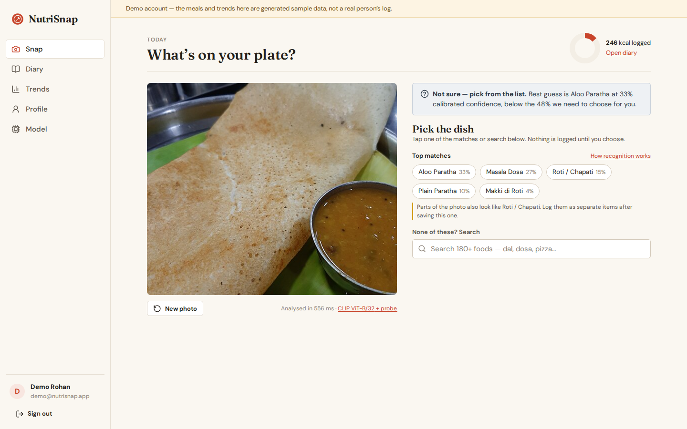
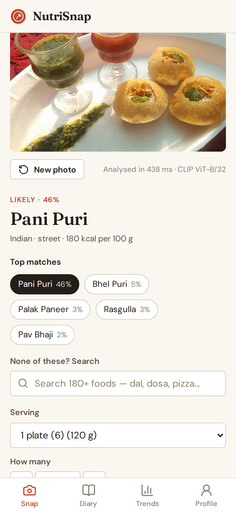
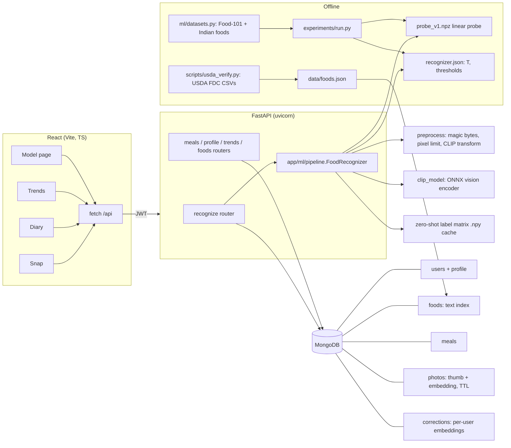
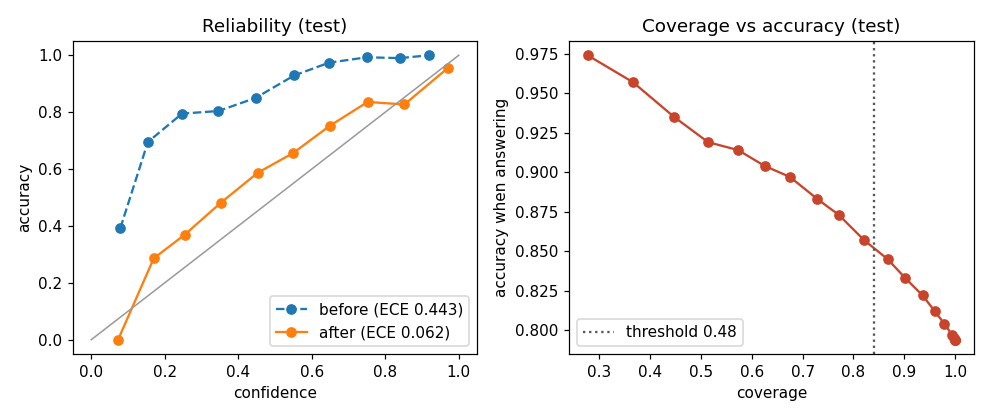

# NutriSnap

Photograph your plate, confirm the dish, pick a portion and log calories and macros. Built for Indian meals first. It uses pretrained CLIP with a small linear probe trained on public food photos, and says "not sure" when it isn't.

React + FastAPI + MongoDB · CLIP ViT-B/32 (ONNX, CPU) · scikit-learn · MIT licence

## Demo

| Confident result | Not sure: pick from the list |
|---|---|
|  |  |

| Diary (demo data) | Trends (demo data) | Mobile, 375 px |
|---|---|---|
|  |  |  |

The demo account (`demo@nutrisnap.app` / `demo1234`) contains 30 days of **generated sample meals**, and the app says so in a banner.

## Problem

Calorie trackers expect you to type "roti" and find the right entry among dozens. Most of their databases are built around Western packaged food. Photo-based trackers exist, but they rarely tell you how sure they are or where their nutrition numbers come from. Indian home food (dal, sabzi, roti, dosa) is where both problems are worst.

## Solution

- Take a photo. The app shows the five most likely dishes from a list of 188 (113 Indian) with a **calibrated** confidence.
- If the model is below its confidence threshold, it **doesn't pick for you**. It asks you to choose from the list or search.
- You pick a portion in the units people actually use (1 roti, 1 katori, 1 plate, grams).
- Nutrition values are marked **USDA verified** (95 foods, each linked to its FoodData Central record) or **Estimate — unverified** (93 foods, shown with a dashed border and a ≈ sign).
- When you correct a guess, the app remembers what that photo looked like (only its embedding) and leans towards your answer for similar photos. You can delete this data.
- Diary, targets (Mifflin–St Jeor) and trends sit around this core.

## Architecture



## AI/ML Pipeline

| Stage | What happens | Code |
|---|---|---|
| Input | Upload ≤ 8 MB. Magic bytes must say JPEG/PNG/WebP. The header is checked for ≤ 40 MP before decoding; minimum 32 px per side | `app/ml/preprocess.py` |
| Preprocessing | EXIF rotate → RGB → shortest side 224 (bicubic) → centre crop → CLIP mean/std → NCHW, batch 1 | `preprocess.clip_tensor` |
| Representation | Pretrained CLIP ViT-B/32 vision tower (8-bit ONNX) → 512-d L2-normalised embedding | `app/ml/clip_model.py` |
| Model | (a) Zero-shot: cosine to 188 label embeddings, each the average of 7 prompts, ×100, softmax. (b) Linear probe (logistic regression, 45 classes) mixed in *inside* its classes | `clip_model.py`, `probe.py`, `pipeline.hybrid` |
| Post-processing | Per-user kNN over corrected photos (optional). Crop-based multi-item hint. Rule-based quality warnings | `personalize.py`, `pipeline.py` |
| Confidence | Temperature scaling (T = 0.446, fitted on val) | `calibration.py` |
| Decision | `not_food` if food score < 0.95; `uncertain` if confidence < 0.48; otherwise `confident` | `pipeline.FoodRecognizer.analyse` |
| API | `POST /api/recognize` → candidates, `decision`, `confidence`, `calibrated`, `abstain_below`, `quality_warnings`, `photo_id` | `app/recognize.py` |
| UI | Preselects only when confident. Shows the reason when not. Model page shows the model card | `frontend/src/pages/Snap.tsx`, `ModelInfo.tsx` |

## Features

- **Snap & log:** upload, phone camera (`capture="environment"`), webcam or drag-drop. Top-5 chips, search over all foods, food-specific servings, live kcal/protein/carbs/fat/fibre, and a meal type suggested from the time of day.
- **Recognition:** calibrated confidence, abstention, not-food guard, quality warnings (dark/blurry), multi-item hint, personalisation from your corrections.
- **Nutrition data provenance:** a verified/estimate badge on every food, a ≈ marker on estimated diary entries, and USDA FDC links.
- **Diary:** meals by type, edit/delete (with a confirm dialog), date navigation, calorie ring and macro bars against targets.
- **Goals:** BMR (Mifflin–St Jeor) → TDEE → target and macro split, with the formula shown using your numbers.
- **Trends:** 7/30 days of calories against target, macro averages and split, streak, most-logged foods; one `$facet` aggregation.
- **Model page:** backbone, what was trained here, calibration settings, measured test metrics, data provenance, privacy, limits.
- **Privacy controls:** see and delete the embeddings kept for personalisation.

## Tech Stack

| Layer | Tools |
|---|---|
| Frontend | React 19, TypeScript, Vite, react-router, lucide-react, plain CSS, self-hosted Fraunces + DM Sans; vitest + Testing Library |
| Backend | FastAPI, Motor (async MongoDB), pydantic v2, bcrypt, PyJWT |
| ML runtime | onnxruntime (CPU), tokenizers, NumPy, Pillow |
| ML offline | scikit-learn (logistic regression), pyarrow (parquet), matplotlib |
| Tests | pytest (real MongoDB), vitest, Playwright (Python) end-to-end |

## Project Structure

```
backend/
  app/
    main.py            lifespan: indexes, food seeding, model load; /api/health
    auth.py            register/login/me, failed-login rate limit
    config.py          settings (+ JWT placeholder guard)
    foods.py meals.py profile.py trends.py recognize.py   routers
    ml/                preprocess · clip_model · probe · calibration · personalize · pipeline
    services/nutrition.py   portions, Mifflin–St Jeor, macro split
  artifacts/           recognizer.json, probe_v1.npz/.json   (small, committed)
  data/                foods.json, usda_mapping.json, usda_verification.json
  ml/                  datasets.py, embeddings.py, fetch_testset.py, class_mapping.json, testset/manifest.json
  scripts/             download_models.py, seed.py, usda_verify.py
  tests/               50 pytest tests
experiments/           run.py, bench_latency.py, configs/, results/<run>/, reports/
frontend/src/          pages/, components/, lib/ (+ *.test.tsx)
e2e/                   test_e2e.py, run_e2e.sh
data/README.md         dataset sources, licences, hashes
docs/                  AUDIT.md, MODEL_CARD.md, screenshots/
```

## Installation

### Windows (PowerShell)

Prerequisites: Python 3.11+, Node 20+, and MongoDB Community Server running on `localhost:27017`.

```powershell
git clone <repo-url> nutrisnap
cd nutrisnap\backend
python -m venv .venv
.venv\Scripts\activate
pip install -r requirements.txt          # add -r requirements-dev.txt for tests / experiments
copy .env.example .env
python -c "import secrets; print(secrets.token_urlsafe(48))"   # paste into JWT_SECRET in .env
python -m scripts.download_models        # ~155 MB, one time
python -m scripts.seed                   # foods + demo account (generated meals)

cd ..\frontend
npm install
```

### macOS / Linux

Same steps, with `source .venv/bin/activate` and `cp .env.example .env`. On macOS, `brew install mongodb-community` gives you a local MongoDB.

## Environment Variables

Set in `backend/.env`:

| Name | Required | Default | Purpose |
|---|---|---|---|
| `ENV` | no | `development` | `production` refuses to start without a real `JWT_SECRET` |
| `JWT_SECRET` | yes in production | – (random per process in development, with a warning) | Signs session tokens; at least 32 characters |
| `JWT_EXPIRE_MINUTES` | no | `10080` | Session length |
| `MONGO_URI` | no | `mongodb://127.0.0.1:27017` | MongoDB connection |
| `MONGO_DB` | no | `nutrisnap` | Database name |
| `CORS_ORIGINS` | no | `http://localhost:5176,http://127.0.0.1:5176` | Allowed browser origins |
| `MAX_UPLOAD_MB` | no | `8` | Upload size limit |
| `ONNX_THREADS` | no | `2` | CPU threads for inference |
| `MODEL_DIR` | no | `backend/models` | ONNX files and label cache |
| `ARTIFACTS_DIR` | no | `backend/artifacts` | Calibration settings and probe |
| `KNN_MEMORY_LIMIT` | no | `500` | Maximum stored corrections used per request |
| `LOGIN_MAX_FAILURES` / `LOGIN_WINDOW_SECONDS` | no | `5` / `300` | Failed-login limit per IP + email |

For the frontend, `VITE_BACKEND` (default `http://127.0.0.1:8004`) is the target of the dev-server proxy.

## Running Locally

```powershell
# terminal 1
cd backend; .venv\Scripts\activate
uvicorn app.main:app --reload --port 8004        # http://127.0.0.1:8004/docs

# terminal 2
cd frontend
npm run dev                                      # http://localhost:5176
```

The first start builds the zero-shot label cache, which takes about 15 s. If the ONNX files are missing, the app still runs: search and manual logging work, `/api/health` reports `"status": "degraded"`, and `/api/recognize` returns 503 with instructions.

## Training

The only model trained in this project is the **linear probe**: a multinomial logistic regression on frozen CLIP embeddings. CLIP itself is used as downloaded.

```powershell
cd backend
pip install -r requirements-ml.txt
python -m ml.datasets        # samples Food-101 (30 classes) + Indian Food Images (15 classes); ~1 GB download
python ..\experiments\run.py --config ..\experiments\configs\main.yaml
```

`run.py` embeds all images (about 10 minutes on 2 CPU cores; cached afterwards), picks the probe's C and the hybrid weight on val, fits the temperature, abstention and not-food thresholds on val, scores test, and writes `backend/artifacts/recognizer.json` and `probe_v1.npz/.json`. The sidecar JSON records the run id, date, dataset manifest hashes, sizes, C, seed, library versions and metrics.

## Evaluation

Metrics, and why each one:

- **Top-1 / top-5 accuracy.** The UI shows five choices, so top-5 is what decides whether the user can fix a mistake with one tap.
- **Macro top-1.** Class sizes differ (the Indian classes have 34–134 test images).
- **ECE, Brier, NLL and a reliability table.** The API exposes a probability, so it should mean what it says.
- **Coverage vs accuracy.** This is the trade-off that sets the "not sure" threshold.
- **Not-food guard:** flag rates at the chosen threshold, plus ROC-AUC.

Splits: train 1,800 / val 900 / test 2,461 real photos. Food-101 test photos come from its official held-out split. Everything is tuned on val. A separate set of 79 hand-picked Wikimedia Commons photos is kept as an out-of-distribution check; 23 of them belong to classes the probe never saw. Details: [data/README.md](data/README.md).

## Experiments

See [experiments/README.md](experiments/README.md) for the run table and how to add a run. The full write-up is in [experiments/reports/2026-09-16_main.md](experiments/reports/2026-09-16_main.md).

## Results

All numbers come from runs made on **2026-09-16** and are stored in `experiments/results/`. No synthetic data was used in any of them.

**Accuracy, test split** (Food-101 30 classes + Indian Food Images 15 classes, 2,461 photos; run `2026-09-16_main`)

| Model | Classes | Top-1 | Top-5 | Indian top-1 |
|---|---|---|---|---|
| Majority class | – | 2.0% | 10.0% | 0.0% |
| Zero-shot, single prompt | 188 | 52.3% | 69.0% | 23.3% |
| Zero-shot, 7-prompt ensemble | 188 | 55.2% | 78.8% | 25.9% |
| Zero-shot ensemble, restricted to the 45 labelled classes | 45 | 68.1% | 88.7% | 42.8% |
| Linear probe on frozen CLIP embeddings | 45 | 92.5% | 99.2% | 94.0% |
| **Hybrid (app model)** | 188 | **79.4%** | **97.3%** | **76.1%** |

**Calibration and abstention** (same run)

| | Value |
|---|---|
| Temperature (fitted on val) | 0.446 |
| ECE test, before → after | 0.443 → 0.062 |
| Abstention threshold (val target: 85% accuracy) | 0.48 |
| Test coverage / accuracy when answering | 84.0% / 85.1% |
| Declined test photos: correct dish in top-5 | 90.1% |



**Out-of-distribution: hand-picked Commons photos (79)**

| Model | Top-1 | Top-5 |
|---|---|---|
| Single prompt | 36.7% | 51.9% |
| Ensemble | 50.6% | 76.0% |
| Hybrid | 63.3% | 83.5% |

**Not-food guard:** 88.9% of non-food test images flagged (16/18), 0.73% of food images wrongly flagged (18/2,461), threshold 0.95 chosen on 18 val images. The non-food sample is small.

**Simulated personalisation:** top-1 goes from 79.4% to 81.8% with ≤ 3 corrected photos per class, and to 83.9% with all 215.

**Latency** (`2026-09-16_latency`, 2 CPU threads, shared machine): `/api/recognize` median 70.6 ms for the whole image; 352 ms with the 5 extra crops for the multi-item hint.

**Nutrition data** (`backend/data/usda_verification.json`): 95 of 188 foods verified against USDA FoodData Central (29 of 113 Indian dishes). Compared with those 95 records, the original hand-written estimates had a median kcal error of **11%**, and some were far off: pakora 320 vs 125 kcal/100 g, chicken biryani 180 vs 104, falafel 333 vs 514.

**Not measured:** accuracy on real users' phone photos (*Dataset required before evaluation.*), and accuracy of the serving-size weights (*Not measured yet.*).

## Error Analysis

`experiments/results/2026-09-16_main/errors.json` lists the top confusion pairs for the app model and for zero-shot, the 30 most confident mistakes (with dataset row ids), and per-class accuracy. What stands out:

1. **Wrapped foods collapse onto "shawarma".** 44% of kathi rolls and 44% of breakfast burritos are predicted as shawarma, and 8 of the 10 most confident mistakes (confidence ≥ 0.97) are shawarma. Shawarma is not one of the probe's classes, so zero-shot keeps sending probability there, and the probe cannot push it back.
2. **Flatbreads get confused with each other:** naan → aloo paratha (28%), and chole bhature → aloo paratha or aloo tikki.
3. **Colour drives zero-shot mistakes:** jalebi → *orange* (35% zero-shot, 19% hybrid), kofta → paneer butter masala (31% zero-shot), pav bhaji → dal makhani (28% → 11%).
4. **Some mistakes are label overlap, not model errors:** Caesar and Greek salad → "green salad" (28%, 18%).
5. **Zero-shot vs probe on Indian dishes:** zero-shot was almost useless on kofta (1.5%), pakora (1.3%) and chole bhature (0%). The probe lifts these to 69–80%. With only 40 training photos per class, a supervised layer matters most for dishes CLIP rarely saw labelled.

Fixes that follow from this are listed under Future Work: add a probe class for shawarma and wraps, and add more flatbread training data.

## API Documentation

Interactive docs are at `http://127.0.0.1:8004/docs`. Every error has the shape `{"detail": ..., "code": ...}`. All routes except auth, foods and model info require `Authorization: Bearer <token>`.

| Method | Path | Purpose |
|---|---|---|
| POST | `/api/auth/register`, `/api/auth/login` | Account and JWT (login: 5 failures per 5 min → 429) |
| GET | `/api/auth/me` | Current user (`has_profile`) |
| GET | `/api/health` | `ok` / `degraded`, DB and model state |
| GET | `/api/model` | Model card (backbone, settings, metrics, limitations) |
| GET | `/api/recognize/status` | Model loaded? |
| POST | `/api/recognize?multi=&hour=` | Multipart `image` → top-5 `candidates`, `decision`, `confidence`, `calibrated`, `abstain_below`, `not_food`, `food_score`, `also_detected`, `quality_warnings`, `personalized`, `photo_id` |
| GET | `/api/photos/{id}` | Your thumbnail |
| GET / DELETE | `/api/corrections` | What personalisation learned / delete it |
| GET | `/api/foods?q=&limit=&skip=` | Search (prefix + alias + `$text`) |
| GET | `/api/foods/meta` | Verified vs estimated counts |
| GET | `/api/foods/{id}` | Food with servings, `verified`, `source_id`, `source_url` |
| POST | `/api/meals` | Log a food (nutrients computed on the server) |
| GET | `/api/meals?date=` | Day grouped by meal type with totals (aggregation) |
| GET | `/api/meals/history?limit=&before=` | Cursor pagination |
| PATCH / DELETE | `/api/meals/{id}` | Edit portion, food, meal type or date / delete |
| GET / PUT | `/api/profile` | Profile + targets with formula |
| POST | `/api/profile/estimate` | Live preview of targets |
| GET | `/api/trends?days=&end=` | Series, averages, streak, top foods (`$facet`) |

## Screenshots

Captured by the e2e run from the running app (`docs/screenshots/`):

| File | Shows |
|---|---|
| `snap-desktop.png` | Confident result, USDA-verified pizza, portion and macros |
| `snap-uncertain-desktop.png` | A dosa photo the model is unsure about; no preselection |
| `diary-desktop.png`, `trends-desktop.png` | Demo account (generated data, banner visible) |
| `model-desktop.png` | Model card page |
| `snap-mobile.png`, `diary-mobile.png`, `trends-mobile.png` | 375 px layout with bottom tabs |

## Technical Deep Dive

**Why CLIP?** No labelled Indian food dataset that is large and clearly licensed was available, and training a CNN on a 2-core CPU isn't realistic. CLIP gives a strong image representation plus zero-shot naming, so adding a food is one line of text. Quantised ONNX keeps the download at 155 MB and inference at about 65 ms on a laptop CPU, with no PyTorch on Windows.

**Why this preprocessing?** It is exactly what CLIP was trained with (bicubic resize of the short side, centre crop, CLIP mean/std). Anything else shifts the embedding distribution. EXIF rotation matters because phone photos are often stored sideways. Batch size is 1 because dynamic quantisation computes activation ranges per batch, so a batch would change individual results.

**Baselines.** A majority-class baseline (2%) shows the task isn't trivial. The single-prompt zero-shot model is the phase-1 baseline. Zero-shot restricted to the 45 labelled classes separates "the probe is better" from "the probe has fewer classes to choose from" (68.1% vs 92.5%, so the probe really is better).

**Features.** Frozen 512-d CLIP image embeddings, with no hand-crafted features. The probe is a logistic regression on them. It is linear, fast, and trains in seconds on 1,800 examples. C was chosen from {0.1 … 30} on val.

**Why the hybrid mixes only inside the probe's classes.** A plain average would push every class the probe never saw to near zero, so the app could never answer "idli" again. With the within-group mix, zero-shot still decides how likely the photo is to be one of the 45, and the probe decides which of them. On Commons photos from unseen classes, top-1 didn't drop (21.7% → 26.1%).

**Inference.** Decode and validate → embed → zero-shot (a matrix multiply with a cached 188×512 matrix) → probe (a 45×512 matrix multiply) → temperature → optional kNN → decision. Only the vision tower runs per request. The text tower runs once per food-list change, and the result is cached by hash.

**Confidence.** Raw CLIP softmax was under-confident here (mean 0.35 while 79% correct). Temperature scaling is a one-parameter fix: it doesn't change the ranking, is fitted on val, and cut ECE from 0.44 to 0.06. The abstention threshold comes from the val coverage curve (the lowest threshold that reaches 85% accuracy) and held on test (85.1%).

**Failure modes.** Wraps → shawarma, flatbread mix-ups, colour-driven gravy confusions, mixed plates (one label for a thali), unusual lighting (a dark-photo warning exists but doesn't change the prediction), and out-of-distribution photos (63% top-1 on Commons vs 79% on the test split). Personalised probabilities aren't calibrated; the API says so with `calibrated: false`.

**Metrics that matter for this product.** Top-5 accuracy, because the user can fix a wrong guess with one tap. Accuracy when answering, because a wrong preselected dish gets logged by people who don't look closely. Nutrition error, because a correct dish name with a 40% wrong calorie value is still a bad log; that is why the provenance badge exists.

**Data required next.** Real phone photos of home-cooked Indian meals with dish labels and, ideally, weighed portions. Also more non-food images for the guard. The class mapping and loaders make it straightforward to add a new labelled set.

**Scaling.** Inference is stateless apart from the per-user memory (at most 500 embeddings per request). Several uvicorn workers or replicas work as-is, except the login rate limiter, which is in-memory and would need Redis. For much larger per-user memories, a vector index (e.g. MongoDB Atlas Vector Search) would replace the brute-force kNN. Photos are small thumbnails in MongoDB; at scale they would move to object storage.

**What changes for production.** HTTPS; `ENV=production` with a real secret; image storage outside the database; a shared rate limiter; request logging with correlation ids; model files pinned by checksum; periodic re-calibration on real user photos (with consent); an opt-in to use corrections for training a better probe; a UI for editing portions based on actual weighed data.

**Viva questions, short answers**

- *Did you train CLIP?* No. I use OpenAI's pretrained weights (Xenova's ONNX export). I trained a logistic-regression probe on top of the frozen embeddings.
- *Why is the probe's 92.5% not the headline?* It only chooses among 45 classes known to be present, and its test photos come from the same sources as its training photos. The app has to choose among 188 classes: 79.4%.
- *What does temperature < 1 mean?* The raw probabilities were too flat; dividing the log-probabilities by 0.446 sharpens them without changing the ranking.
- *How is the threshold chosen without touching test?* From the val coverage–accuracy curve. Test is only reported.
- *Why are only half the foods verified?* Only foods with a same-dish USDA record were mapped. Many Indian dishes (poha, rajma curry, dhokla…) have no queryable authoritative record, so they stay labelled as estimates.
- *What is stored about my photos?* A 480 px thumbnail without EXIF (deleted after 24 h unless logged) and a 512-number embedding. Embeddings of corrected photos are kept for personalisation until you delete them.

## Deployment

Live demo: not deployed yet.
Repository: not published yet.

Production setup: React build on **Vercel** (`frontend/vercel.json` rewrites `/api/*` to the API),
FastAPI in **Docker on Render** (`render.yaml`, `backend/Dockerfile`), data in **MongoDB Atlas**.
Step-by-step instructions, environment variables and measured memory use are in
[docs/DEPLOYMENT.md](docs/DEPLOYMENT.md).

## Limitations

- **Closed food list** (188 foods). The probe covers only 45 of them.
- **Uneven nutrition data:** 93 foods have unverified estimates, and serving weights are estimates for all foods.
- **No portion estimation from the image**, and no detection of several dishes (only a crop hint).
- **Unrepresentative evaluation photos:** web and restaurant photos with a single seed; no real user photos yet.
- **Small not-food evaluation** (36 images).
- **Personalisation constants are hand-set**, and the similarity gate is not very selective (it fired on 95% of test photos).
- **Single-process rate limiter;** the JWT is stored in localStorage.

## Future Work

- **Wider probe coverage:** add shawarma/wrap, paratha and roti classes, and extend the probe to more foods using Indian food datasets with clear licences.
- **Nutrition data:** verify more Indian dishes against IFCT 2017 or INDB where machine-readable data is available, and weigh common household servings.
- **Real user photos:** collect them (opt-in), re-calibrate, and evaluate by cuisine and lighting.
- **Personalisation:** tune the kNN gate on real per-user data, or learn a per-user probe.
- **Portion estimation:** a reference object or depth from phone cameras.

## Testing

Results from the final run on 2026-09-16:

| Suite | Command | Result |
|---|---|---|
| Backend (pytest, real MongoDB) | `cd backend && python -m pytest -q` | 50 passed |
| Frontend unit (vitest + Testing Library) | `cd frontend && npm test` | 21 passed |
| Type-check + build | `cd frontend && npm run build` | passes |
| End-to-end (Playwright, headless Chromium) | `bash e2e/run_e2e.sh` | 1 journey passed |

- **pytest** covers auth, rate limiting, JWT guard, CORS, food search and provenance, meals CRUD and user isolation, trends, nutrition maths, ML units (preprocessing, hybrid, temperature fitting, threshold picking, probe round-trip, kNN), and recognition robustness: empty, non-image, truncated, tiny, 81 MP pixel bomb, dark photo, low-confidence path, missing model files, corrupt model files, and the model card.
- **The e2e test** registers a user, sets a profile (checks 2,090 kcal), uploads a real pizza photo (checks the USDA badge), logs 2 slices (532 kcal), edits to 2.5 slices (665), checks trends, cancels a delete dialog, opens the model page, uses the demo account (checks the demo banner and the "not sure" state), and takes desktop and 375 px screenshots.
- **CI:** `.github/workflows/ci.yml` runs pytest (with a MongoDB service container and cached model download) plus the frontend build and vitest. It has not been run on GitHub yet.

On Windows, run the e2e script from **Git Bash** with the backend virtual environment active, and point it at that interpreter: `PYTHON=python bash e2e/run_e2e.sh`. Install the browser once with `python -m playwright install chromium`.

## License

MIT, see [LICENSE](LICENSE). The CLIP weights are MIT-licensed (OpenAI). Datasets keep their own terms (see [data/README.md](data/README.md)); no dataset images are included in this repository. The two test fixture photos are CC BY-SA 4.0 (`backend/tests/fixtures/ATTRIBUTION.txt`).
