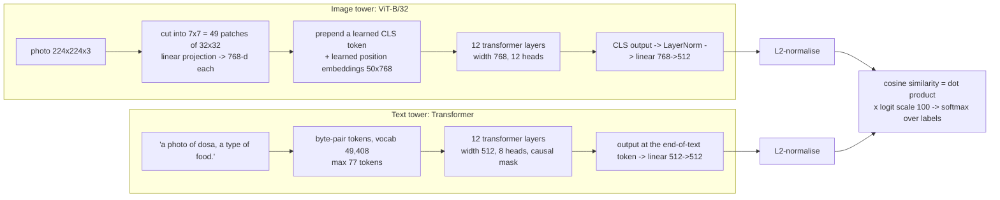
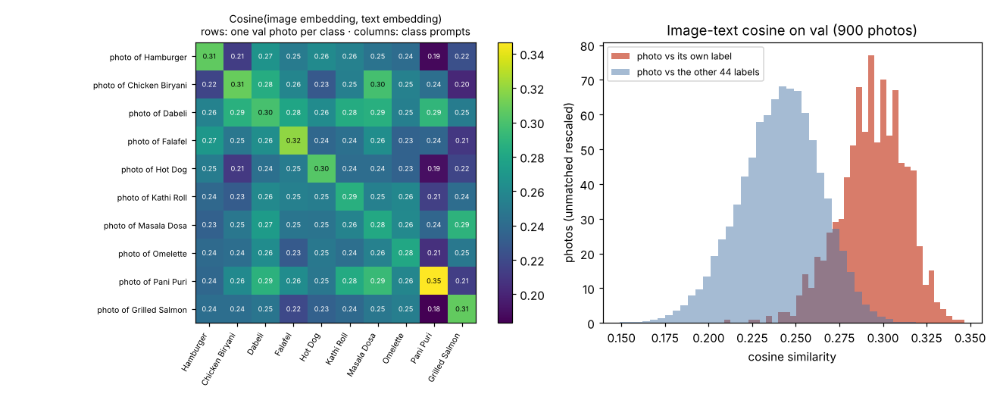

# How CLIP works, and why it can classify food it was never trained to classify

NutriSnap's recogniser is OpenAI's **CLIP ViT-B/32** (Radford et al., *Learning Transferable Visual
Models From Natural Language Supervision*, 2021), run as ONNX on CPU. This page explains the
architecture, how image and text embeddings are made, why cosine similarity between them works as a
classifier, and what the measurements in this repository show. Shapes marked *(read from file)* come
from the ONNX weights via `experiments/compare/clip_explain.py`, not from memory. The results are in
[`experiments/results/2026-11-26_clip_explain/clip.json`](../experiments/results/2026-11-26_clip_explain/clip.json).

## 1. Two encoders, one shared space



| | Image tower | Text tower |
|---|---|---|
| Input | 224×224 RGB, CLIP mean/std normalisation | ≤ 77 BPE tokens, start and end-of-text tokens |
| Tokenisation | 49 non-overlapping 32×32 patches, each flattened and projected (a 32×32 conv with stride 32: weight `768×3×32×32` *(read from file)*), plus 1 CLS token = 50 tokens | token embedding `49408×512` *(read from file)* |
| Position | learned, `50×768` *(read from file)* | learned, `77×512` *(read from file)* |
| Body | 12 pre-LayerNorm transformer blocks (multi-head self-attention + MLP 768→3072→768) | 12 blocks, width 512, causal (each token sees only earlier ones) |
| Pooling | the CLS token's output | the output at the end-of-text token (the highest token id, 49407) |
| Projection | `768→512` *(read from file)* | `512→512` *(read from file)* |
| Layers | 12 *(read from file)* | 12 *(read from file)* |
| Parameters | 87.8 M *(read from file)* | 63.4 M *(read from file)* |

Both towers end in the **same 512-dimensional space**, and both outputs are L2-normalised, so every
embedding lies on the unit sphere and the dot product of two embeddings *is* their cosine similarity.

## 2. How it was trained: contrastive learning on 400 M image-text pairs

CLIP was never trained on "class 17 = pizza". It was trained on about 400 million (image, caption)
pairs from the web, with one objective. In a batch of N pairs (N = 32,768 in the paper), compute the
N×N matrix of cosine similarities between every image and every caption, multiply by a learned scale,
and apply cross-entropy **in both directions**: each image must pick its own caption among the N, and
each caption must pick its own image.

```
logits = s * (I @ T.T)            # I, T: N x 512, L2-normalised; s = exp(learned t), ends at 100
loss   = ( CE(logits, arange(N)) + CE(logits.T, arange(N)) ) / 2      # InfoNCE, symmetric
```

To win this game, the image tower must put photos close to captions that describe them, and the text
tower must place descriptions where matching photos land. With 400 M captions, "masala dosa",
"pizza", "a bowl of ramen" and countless other food words appear next to photos of those foods,
so the space becomes organised by *meaning* that both modalities share.

## 3. Why that gives a classifier for free (zero-shot)

A conventional classifier ends in a weight matrix `W` (classes × features) learned from labelled photos
of exactly those classes: `logits = W f`. Zero-shot CLIP **builds `W` from text instead**:

1. For each food, write prompts such as `"a photo of dosa, a type of food."`.
2. Run them through the text tower and L2-normalise. Each row of `W` is the text embedding of one class.
3. For a photo, `logits = 100 · f Wᵀ`, then softmax.

That is the same `logits = W f` shape as a supervised linear layer. The weights come from the language
side of a model trained to match images to descriptions, not from labelled food photos. Adding a new
dish is one line of text and needs no retraining. This is why NutriSnap can rank **188 foods although
only 45 have any labelled photos here**. On 23 Commons photos of dishes outside those 45, the CNN and
probe models score 0% by construction, while zero-shot CLIP gets 82.6% top-1 and 100% top-5 with the
fp32 text tower ([COMPARISON.md](COMPARISON.md)).

It works because:

- **The label is in the training signal.** Captions on the web already contain dish names, so "dosa" was
  learned as a direction in the space even though nobody labelled a dosa dataset.
- **Contrastive training makes the space discriminative.** It pushed apart captions that did not match,
  so different dishes sit in different directions.
- **Cosine plus softmax is exactly the training-time decision rule.** Zero-shot classification is the
  same task CLIP was trained on (pick the matching caption among N), with N = the number of foods.

## 4. What the measurements show

Measured on the 900 val photos with the app's model (INT8 vision and text towers), 45 classes:

**Cosine similarities are small, and the logit scale is what turns them into decisions.**

| Pair | Mean cosine |
|---|---|
| photo vs its own label's text | 0.294 |
| photo vs the other 44 labels | 0.241 |
| photo vs photo, same dish | 0.750 |
| photo vs photo, different dish | 0.617 |
| label text vs label text | 0.907 |
| mean photo embedding vs mean text embedding | 0.323 |

Images cluster with images and texts with texts, the *modality gap*. A photo's best match is never
"close" in absolute terms (≈ 0.3). What matters is that its own label is *relatively* closest.
Multiplying by the logit scale of 100 turns a 0.05 cosine gap into 5 logits, which is about 150× the
probability. Changing the scale never changes the ranking, only the confidence:

| Logit scale | Val top-1 | Mean confidence | ECE |
|---|---|---|---|
| 10 | 70.1% | 0.04 | 0.663 |
| 50 | 70.1% | 0.24 | 0.465 |
| **100 (CLIP's learned value)** | 70.1% | 0.56 | 0.144 |
| 200 | 70.1% | 0.79 | 0.089 |

That is why temperature scaling is safe: it is the same knob, fitted on val.



**Prompt wording matters, and averaging prompts helps.** Val top-1 for each prompt alone vs the
ensemble (the mean of the 7 normalised text embeddings, re-normalised):

| Prompt | 45 classes | 188 foods |
|---|---|---|
| `a photo of {name}, a type of food.` | 62.8% | 54.4% |
| `a photo of {desc}.` | 69.1% | 55.0% |
| `a close-up photo of {desc}.` | 68.4% | 54.4% |
| `a top-down photo of a plate of {name}.` | 60.1% | 50.6% |
| `a photo of {name} served in a restaurant.` | 62.6% | 51.4% |
| `a homemade {name} on a table.` | 64.8% | 54.4% |
| `a photo of {name}, a popular {cuisine} dish.` | 62.7% | 53.1% |
| **Ensemble of all 7** | **70.1%** | **59.0%** |

Descriptive prompts (`{desc}`, e.g. "masala dosa, a crispy rice crepe folded over potato filling" instead of just
"masala dosa") help most for unfamiliar names. The ensemble beats every single prompt because the
average cancels wording-specific noise.

**Labels that sit together in text space get confused.** The closest pairs among the 188 foods include
Paneer Tikka / plain Paneer (0.990), Chicken Tikka / Chicken 65 (0.988), Pav / Pav Bhaji (0.987),
Idli / Puttu (0.985) and Dal Tadka / Dal Baati (0.985). When two class vectors are nearly parallel, a
photo can barely prefer one of them, which predicts the confusions in the error analysis. A
supervised probe on image embeddings separates them; prompts alone can't.

**Zero-shot vs supervised, side by side** (test, 45 classes; [COMPARISON.md](COMPARISON.md)):

| | Labelled food photos | Test top-1 | Can name dishes it never saw |
|---|---|---|---|
| CNN from scratch | 1,800 | 34.9% | no |
| ImageNet ResNet-50 fine-tuned | 1,800 (+ 1.28 M ImageNet) | 82.4% | no |
| CLIP zero-shot (fp32 text) | **0** | **86.4%** | **yes: 82.6% top-1 on 23 new-dish photos** |
| CLIP + linear probe | 1,800 | 92.3% | no (probe part), yes (hybrid in the app) |

## 5. Where zero-shot falls short, and how the app adapts CLIP

- **A degraded text tower.** The app's INT8 text tower gives embeddings with only 0.74 cosine to fp32.
  With it, zero-shot top-1 on Indian dishes is 42%. With the fp32 text tower it is 86%. The main run
  blamed rare dish names (kofta 1.5%, pakora 1.3%), but most of the gap was quantisation. See
  [COMPARISON.md](COMPARISON.md).
- **Rare or regional dishes.** Names that are rare in web captions still give weaker text embeddings.
  Even with fp32 text, Indian top-1 (85.7%) trails the probe (93.6%).
- **Look-alike names.** Labels close together in text space get confused (section 4).
- **Calibration depends on the text side.** With INT8 text embeddings, the raw softmax is too flat
  (fitted T = 0.70). With fp32 text, it is already calibrated (ECE 0.015, T = 1.06).

The fixes compared in [COMPARISON.md](COMPARISON.md) keep the CLIP towers frozen and add a little
supervision:

| Method | What is learned | From how many photos |
|---|---|---|
| Prompt ensemble (app) | nothing; average 7 prompt embeddings per class | 0 |
| Linear probe (app) | a 45×512 logistic regression on image embeddings | 40 per class |
| Hybrid (app) | probe decides *within* its 45 classes, zero-shot decides the rest of the 188 | 40 per class |
| Tip-Adapter | nothing trained: a cache of training embeddings + two numbers (α, β) chosen on val | 1–40 per class |
| Temperature scaling (app) | 1 number fitted on val so confidence matches accuracy | val split |

## 6. Further reading

- Radford et al. 2021, *Learning Transferable Visual Models From Natural Language Supervision* (CLIP).
- Dosovitskiy et al. 2021, *An Image is Worth 16x16 Words* (ViT).
- Zhang et al. 2022, *Tip-Adapter: Training-free Adaption of CLIP for Few-shot Classification*.
- Liang et al. 2022, *Mind the Gap: Understanding the Modality Gap in Multi-modal Contrastive Representation Learning*.
- Guo et al. 2017, *On Calibration of Modern Neural Networks* (temperature scaling).
