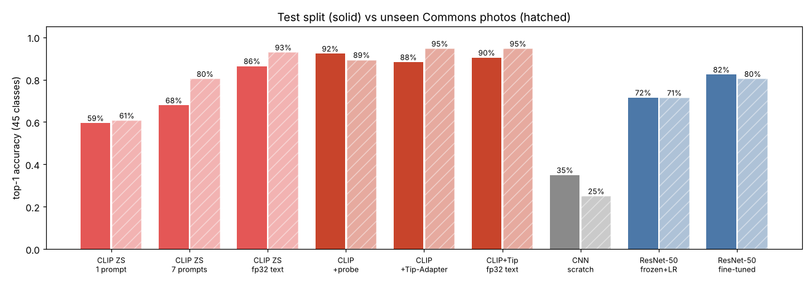
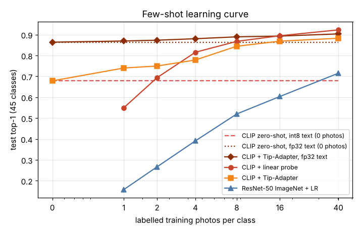
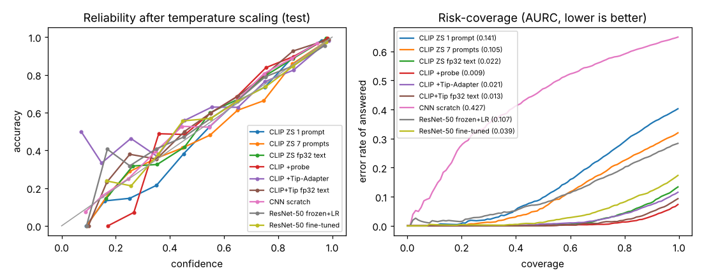

# CNN vs transfer learning vs CLIP: comparison on the same photos

Runs `2026-11-26_compare` ([metrics.json](../experiments/results/2026-11-26_compare/metrics.json)),
`2026-11-26_onnx` ([onnx.json](../experiments/results/2026-11-26_onnx/onnx.json),
[text_precision_zero_shot.json](../experiments/results/2026-11-26_onnx/text_precision_zero_shot.json)) and
`2026-11-26_clip_explain` ([clip.json](../experiments/results/2026-11-26_clip_explain/clip.json)).
Code: [experiments/compare/](../experiments/compare/README.md). All on a 4-core CPU VM, no GPU, no
synthetic data.

**Setup.** Every model predicts the same **45 classes** (30 Food-101 + 15 Indian Food Images) on the
same splits: train 1,800 (40 per class), val 900, test 2,461. A prediction is correct if it is in the
photo's accept set ([DATASET.md](DATASET.md)). Everything chosen (epoch, C, α/β, temperature, threshold)
is chosen on val. The **unseen photos** are 79 hand-picked Wikimedia Commons photos from other
photographers: 56 belong to the 45 classes, and 23 are dishes no model was trained on.

## The headline finding: the app's INT8 text tower was costing ~19 points (now fixed)

The app runs CLIP's text tower as an 8-bit quantised ONNX file to build its cached label embeddings.
Those embeddings have only **0.74 cosine similarity** to the full-precision (fp32) ones. Rebuilding the
same 7-prompt label matrix with the fp32 text tower, with nothing else changed:

| Zero-shot CLIP, 7 prompts | Test top-1 (45) | Indian top-1 | Test top-1 (all 188 foods) | New-dish photos top-1 / top-5 (188) |
|---|---|---|---|---|
| INT8 text tower (app until 2026-11-26) | 67.9% | 42.0% | 55.1% | 21.7% / 47.8% |
| **fp32 text tower** | **86.4%** | **85.7%** | **77.2%** | **82.6% / 100%** |

The text tower runs once per food-list change, and its output is cached, so this gain costs nothing
per request. **Applied to the app on 2026-11-26** (run `2026-11-26_main`). It also corrects an earlier conclusion. The main run (`2026-09-16_main`) attributed weak
zero-shot results on Indian dishes (kofta 1.5%, pakora 1.3%) to those names being rare in CLIP's
training captions. With an accurate text tower, zero-shot Indian top-1 is 85.7%, so most of that
weakness came from quantisation. Both variants appear in every table below.

## 1. The approaches

| # | Approach | Model | What is trained here | Labelled photos |
|---|---|---|---|---|
| 1 | Traditional CNN | 9-conv VGG-style net, batch norm, global average pooling, 2.4 M params, 128 px | all weights from random init; 40 epochs, augmentation; best epoch 35 (val) | 1,800 |
| 2a | Transfer learning, feature extraction | ImageNet-1k ResNet-50 (frozen) + logistic regression on 2048-d features | 92 k params (C = 0.1) | 1,800 + 1.28 M ImageNet |
| 2b | Transfer learning, fine-tuning | same ResNet-50, layer4 + new head trained; 10 epochs, best 8 | 15.1 M params | 1,800 + 1.28 M ImageNet |
| 3a | CLIP zero-shot, 1 prompt | CLIP ViT-B/32 + `"a photo of {name}, a type of food."` (INT8 text) | nothing | **0** (+ 400 M web image-caption pairs) |
| 3b | CLIP zero-shot, 7 prompts (app) | prompt ensemble, INT8 text tower | nothing | **0** |
| 3c | CLIP zero-shot, 7 prompts, fp32 text | same prompts, fp32 text tower | nothing | **0** |
| 4a | CLIP + linear probe (app) | logistic regression on frozen CLIP image embeddings | 23 k params (C = 10) | 1,800 |
| 4b | CLIP + Tip-Adapter | zero-shot classifier + key-value cache of training embeddings ([adapter.py](../backend/app/ml/adapter.py)); INT8 text | **nothing trained**; α = 5, β = 10 (val) | 1,800 |
| 4c | CLIP + Tip-Adapter, fp32 text | same with fp32 text | nothing trained; α = 3, β = 10 | 1,800 |

## 2. Accuracy

| Model | Test top-1 | Top-5 | Macro | Food-101 | Indian | Test w/o 49 duplicates | Unseen photos (56) |
|---|---|---|---|---|---|---|---|
| 1 CNN from scratch | 34.9% | 67.5% | 33.5% | 22.1% | 54.9% | 34.5% | 25.0% |
| 2a ResNet-50 frozen + LR | 71.5% | 93.0% | 71.1% | 66.6% | 79.2% | 71.1% | 71.4% |
| 2b ResNet-50 fine-tuned | 82.4% | 95.6% | 81.5% | 76.2% | 92.1% | 82.1% | 80.4% |
| 3a CLIP zero-shot, 1 prompt | 59.5% | 78.7% | 64.5% | 79.9% | 27.7% | 60.5% | 60.7% |
| 3b CLIP zero-shot, 7 prompts (INT8 text) | 67.9% | 88.8% | 72.7% | 84.4% | 42.0% | 69.0% | 80.4% |
| 3c **CLIP zero-shot, fp32 text** | 86.4% | 98.0% | 86.6% | 86.8% | 85.7% | 86.3% | 92.9% |
| 4a **CLIP + linear probe** | **92.3%** | **99.2%** | **92.4%** | **91.4%** | **93.6%** | **92.1%** | 89.3% |
| 4b CLIP + Tip-Adapter | 88.3% | 98.8% | 88.2% | 88.1% | 88.6% | 88.0% | **94.6%** |
| 4c CLIP + Tip-Adapter, fp32 text | 90.4% | 99.0% | 90.1% | 89.5% | 91.8% | 90.2% | **94.6%** |

- **Pretraining matters more than architecture.** The same 1,800 photos give 35% from scratch, 72–82%
  on ImageNet features, and 88–92% on CLIP features. Forty photos per class is far too few to learn
  visual features from scratch: the scratch CNN overfits to colour and texture and drops to 25% on
  the unseen photos.
- **Zero-shot CLIP (fp32 text), with no food photos, beats a ResNet-50 fine-tuned on all 1,800**
  (86.4% vs 82.4%) and generalises better to the unseen photos (92.9% vs 80.4%).
- **Adaptation still adds 4–6 points:** the linear probe reaches 92.3%, and Tip-Adapter 90.4% with
  nothing trained.
- **The 49 duplicates do not change conclusions.** Removing the test photos that duplicate train/val
  photos (see [DATASET.md](DATASET.md)) moves every model by under 0.5 points.
- **Small sample:** there are only 56 unseen photos (one photo ≈ 1.8 points). Use them for ranking, not
  exact values.

## 3. New dishes: why CLIP can classify without per-class training

23 unseen photos show dishes outside the 45 training classes (idli, poha, palak paneer, paneer tikka,
butter chicken, gulab jamun). Approaches 1, 2 and 4a end in a fixed 45-way output layer, so they **cannot
output these dishes: 0% by construction**. Zero-shot CLIP ranks all 188 foods in the app's list, because
each class is just a text embedding:

| On the 23 new-dish photos (188-way) | Top-1 | Top-5 |
|---|---|---|
| CNN / ResNet / probe (fixed 45 outputs) | 0% | 0% |
| CLIP zero-shot, 1 prompt (INT8 text) | 0.0% | 17.4% |
| CLIP zero-shot, 7 prompts (INT8 text, the app's until 2026-11-26) | 21.7% | 47.8% |
| **CLIP zero-shot, 7 prompts, fp32 text** | **82.6%** | **100%** |

Adding a dish to a conventional classifier means collecting labelled photos and retraining. For CLIP
it means writing its name. Why this works is explained in [CLIP.md](CLIP.md).

## 4. Few-shot learning curve

Test top-1 (45 classes) with k labelled photos per class (3 random draws averaged for k < 16):

| Photos per class | 0 | 1 | 2 | 4 | 8 | 16 | 40 |
|---|---|---|---|---|---|---|---|
| CLIP zero-shot, INT8 text | 67.9% | – | – | – | – | – | – |
| CLIP zero-shot, fp32 text | **86.4%** | – | – | – | – | – | – |
| CLIP + Tip-Adapter, INT8 text | 67.9% | 74.0% | 75.0% | 77.9% | 84.4% | 86.9% | 88.3% |
| CLIP + Tip-Adapter, fp32 text | 86.4% | **87.0%** | **87.3%** | **88.0%** | **89.0%** | 89.3% | 90.4% |
| CLIP + linear probe | – | 55.0% | 69.4% | 81.6% | 86.8% | **89.5%** | **92.3%** |
| ResNet-50 ImageNet + LR | – | 15.8% | 26.7% | 39.1% | 52.0% | 60.4% | 71.5% |

- **A linear probe ignores the text,** so with 1 photo per class it does worse (55%) than using no photos.
  Tip-Adapter starts *from* the zero-shot classifier, so it never falls below it.
- With the fp32 text tower, Tip-Adapter leads up to ~8 photos per class. From 16 photos on, the probe
  pulls ahead.
- ResNet-50 needs 40 photos per class to reach 72%, below what CLIP does with none. ImageNet's 1,000 classes
  don't name dishes, so its features need many examples to separate them.
- **Product implication:** for a dish with no or few photos, rely on zero-shot or Tip-Adapter. Once a dish
  has 15+ photos, the probe is best. The app's hybrid already does the second half.

## 5. Confidence and uncertainty

Each model's probabilities were temperature-scaled on val (one parameter, ranking unchanged).
**AURC** is the area under the risk-coverage curve: the mean error rate when answering only the
most-certain fraction, averaged over all fractions. Lower is better. It measures how well a certainty
score ranks right answers above wrong ones, independent of any threshold. *Oracle* is the best possible
AURC at that accuracy.

| Model | T | ECE before → after | NLL after | AURC: max-prob / −entropy / margin (oracle) | Threshold for 85% on val | Test coverage / accuracy answered |
|---|---|---|---|---|---|---|
| CNN from scratch | 0.92 | 0.046 → 0.023 | 2.36 | 0.427 / 0.434 / 0.436 (0.283) | 0.71 | 9.0% / 89.2% |
| ResNet-50 frozen | 0.81 | 0.098 → 0.031 | 1.04 | 0.107 / 0.115 / 0.105 (0.045) | 0.55 | 67.0% / 85.9% |
| ResNet-50 fine-tuned | 0.66 | 0.180 → **0.014** | 0.67 | 0.039 / 0.041 / 0.039 (0.017) | 0.31 | 95.6% / 85.3% |
| CLIP ZS, 1 prompt | 0.80 | 0.085 → 0.048 | 1.54 | 0.141 / 0.144 / 0.144 (0.096) | 0.56 | 55.9% / 86.9% |
| CLIP ZS, 7 prompts, INT8 text | 0.70 | 0.125 → 0.022 | 1.19 | 0.105 / 0.109 / 0.106 (0.058) | 0.54 | 66.0% / 84.9% |
| CLIP ZS, fp32 text | 1.06 | **0.015** → 0.022 | 0.44 | 0.022 / 0.023 / 0.022 (0.010) | 0.20 | 99.7% / 86.6% |
| CLIP + linear probe | 0.52 | 0.233 → 0.023 | **0.26** | **0.009** / 0.010 / **0.009** (0.003) | 0.00 | 100% / 92.3% |
| CLIP + Tip-Adapter | 1.73 | 0.058 → 0.020 | 0.39 | 0.021 / 0.023 / 0.020 (0.007) | 0.00 | 100% / 88.3% |
| CLIP + Tip-Adapter, fp32 text | 1.74 | 0.040 → 0.015 | 0.31 | 0.013 / 0.014 / 0.012 (0.005) | 0.00 | 100% / 90.4% |

- **Temperature scaling works everywhere:** ECE after scaling is 0.014–0.048. The raw direction
  differs. The probe and fine-tuned ResNet are *under*-confident (T < 1 sharpens). Tip-Adapter is
  *over*-confident (T ≈ 1.7 softens), because its cache adds up to α logits.
- **Zero-shot CLIP with an accurate text tower is already calibrated** (raw ECE 0.015, T = 1.06). The
  "raw CLIP is under-confident" finding in the main run (T = 0.446) was mostly a side effect of the
  INT8 text embeddings.
- **Max-probability is as good a certainty score as entropy or margin here:** the three AURCs are within
  0.01 for every model. That justifies the app's choice of thresholding the calibrated top-1 probability.
  Wrong answers do carry more entropy (probe: 1.20 vs 0.27 nats).
- **Better models need to abstain less.** Zero-shot with INT8 text must decline a third of photos to reach
  85%, and the scratch CNN declines 91%. The adapted CLIP models and fp32-text zero-shot clear 85% while
  answering (nearly) everything.
- On the unseen photos, confidence tracks accuracy: probe mean confidence 0.88 at 89% accuracy,
  fp32-text zero-shot 0.91 at 93%.

## 6. Inference cost and ONNX optimisation

**Per-image latency, batch 1** (medians on a shared 4-core VM; ratios matter more than absolute ms):

| Model | Params | Input | Latency | File |
|---|---|---|---|---|
| CNN from scratch (PyTorch) | 2.4 M | 128 px | 6.4 ms (4 threads) | ≈ 9 MB |
| ResNet-50 (PyTorch eager) | 23.6 M | 224 px | 70.7 ms (2 threads) | 94 MB |
| ResNet-50 → **ONNX fp32** | 23.6 M | 224 px | 35.4 ms (2 threads) | 94 MB |
| ResNet-50 → **ONNX INT8 static** (QDQ, 128 calibration photos) | 23.6 M | 224 px | **10.9 ms** | **24 MB** |
| CLIP ViT-B/32 vision, fp32 | 87.8 M | 224 px | 56.2 ms (2 threads) | 352 MB |
| CLIP vision, fp16 | 87.8 M | 224 px | 56.2 ms | 176 MB |
| CLIP vision, INT8 (Xenova download, **what the app uses**) | 87.8 M | 224 px | 43.8 ms | 89 MB |
| CLIP vision, **INT8 quantised here** (`quantize_dynamic`, QInt8 per-channel, 7 s) | 87.8 M | 224 px | **19.9 ms** | 89 MB |

**Accuracy cost of each precision** (val, 900 photos; INT8 text label matrix for all rows):

| CLIP vision | Cosine to fp32 (mean / min) | Zero-shot top-1 (45) | Zero-shot argmax = fp32's | Linear probe top-1 |
|---|---|---|---|---|
| fp32 | 1 / 1 | 71.2% | 100% | 92.1% |
| fp16 | 1.000 / 1.000 | 71.2% | 100% | 92.1% |
| INT8 Xenova (app) | 0.932 / 0.787 | 70.1% | 79.0% | 89.6% |
| INT8 here | **0.973 / 0.849** | 69.4% | **88.1%** | **91.2%** |

| CLIP text tower | File | Per prompt | Cosine to fp32 | 188-way zero-shot test top-1 |
|---|---|---|---|---|
| fp32 | 254 MB | 9.0 ms | 1 | **77.2%** |
| INT8 (app until 2026-11-26) | 65 MB | 4.8 ms | **0.744** | 55.1% |

| ResNet-50 fine-tuned | Val top-1 | Agrees with PyTorch |
|---|---|---|
| PyTorch | 81.2% | – |
| ONNX fp32 | 81.2% | 100% (max logit difference 0.0) |
| ONNX INT8 static | 79.6% | 93.3% |

- **Threads:** going from 1 to 4 threads cuts CLIP fp32 from 99 to 33 ms (3×).
- **Graph optimisation:** for fp32 and INT8, all levels are within noise (the exports are already fused).
  For **fp16 on CPU, anything below ORT_ENABLE_ALL is 2× slower** (106–112 vs 56 ms), because ORT
  inserts fp16↔fp32 casts around the ops the CPU runs in fp32. fp16 halves the file and gives no speed on CPU.
- **Batching:** fp32 at batch 8 costs 24.5 ms per image vs 33 ms alone. The app keeps batch 1 because
  dynamic INT8 computes activation ranges per batch, which would make results depend on the other
  photos in the batch.
- **ONNX export is lossless** (fp32: identical logits) and 2× faster than PyTorch eager. Static INT8 gives
  another 3.3× at −1.6 points.
- **Where one request's time goes** (app pipeline, INT8 vision, 2 threads): decode + validate 1.2 ms,
  preprocessing 2.4 ms, **vision encoder 45.2 ms (90%)**, zero-shot over 188 foods 0.08 ms,
  probe + hybrid 0.13 ms, temperature + decision 0.03 ms, not-food guard 0.07 ms, quality checks
  1.4 ms. Total 50.5 ms. Only the encoder is worth optimising.

**Recommendations:**

1. **Build the label matrix with the fp32 text tower,** or ship the precomputed 188×512 matrix (385 KB) so
   the server needs no text tower at all. This is the largest accuracy gain found, and it is free at
   request time.
2. **Swap the vision model for the per-channel INT8 quantised here:** 2.2× faster and closer to fp32.

Both change the embeddings that the probe, hybrid weight, temperature and thresholds were fitted on,
so `experiments/run.py` must be re-run (re-fitting on val) before deploying either. **Recommendation 1 is
applied** in run `2026-11-26_main` ([report](../experiments/reports/2026-11-26_main.md)): the app's
zero-shot test top-1 rose from 55.2% to 77.2%, and Commons top-1 from 63.3% to 86.1%. The hybrid's
top-1 on the in-class test split fell 2.1 points (79.4% → 77.3%), for reasons explained in the report.
**Recommendation 2 is applied** in run `2026-11-26_main-int8vision`
([report](../experiments/reports/2026-11-26_main-int8vision.md)): recognition takes 22 ms instead of 47 ms,
and the hybrid's test top-1 is 79.1%.

## 7. Verdict

| Criterion | Best | Runner-up |
|---|---|---|
| Accuracy on the 45 known classes | CLIP + linear probe, 92.3% | Tip-Adapter fp32 text, 90.4% |
| Dishes with no photos | CLIP zero-shot (fp32 text): 82.6% top-1 on new dishes | every non-CLIP model: 0% |
| 1–8 photos per class | CLIP + Tip-Adapter (fp32 text) | linear probe from ~16 photos |
| Unseen photographers / styles | Tip-Adapter, 94.6% | fp32-text zero-shot, 92.9% |
| Calibration | ResNet-50 fine-tuned, ECE 0.014 (after scaling) | fp32-text zero-shot, 0.015 *before* scaling |
| Ranking right above wrong (AURC) | CLIP + linear probe, 0.009 | Tip-Adapter fp32 text, 0.013 |
| Speed / size on CPU | CNN from scratch (6 ms, 9 MB) but 35% accurate | ResNet-50 INT8 ONNX: 11 ms, 24 MB, 80% |
| Training cost | zero-shot / Tip-Adapter: none | linear probe: 11 s; ResNet fine-tune: 24 min; CNN: 28 min |

The app's architecture (CLIP zero-shot over the full 188-dish vocabulary, a linear probe inside the
classes that have photos, temperature scaling, abstention) is what these measurements favour. The two
fixes in §6 would make it substantially better.

## 8. Caveats

- One seed per model. The fine-tuned ResNet and scratch CNN were not repeated, so 1–2 point gaps are not
  significant.
- CNN hyper-parameters were set once, not tuned per model, because of CPU time. A tuned scratch CNN would
  improve, but not to the 70%+ of pretrained models with 40 photos per class.
- Latency is from a shared cloud VM. Re-run `onnx_bench.py` on the deployment machine.
- The few-shot curve picks hyper-parameters on the full val split (20 photos per class), which a real
  1-shot user would not have.
- `clip_explain.py`'s similarity statistics use the INT8 text embeddings (it ran before the fix), so they
  describe the model as it was shipped until 2026-11-26.
