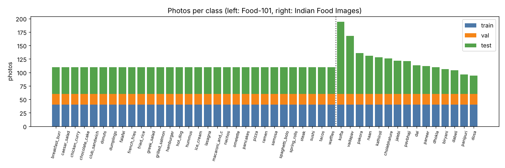

# Dataset documentation (datasheet)

This datasheet covers every image set used to train or evaluate NutriSnap's recognisers. The source
licences and download commands are in [data/README.md](../data/README.md). All numbers below come from
`experiments/compare/dataset_stats.py` (results in
[`experiments/results/2026-11-26_dataset/`](../experiments/results/2026-11-26_dataset/)) and were
measured on the same snapshot as the committed experiments: the row-id hashes `7d1fdca089516c59`
(Food-101) and `56d709d246578e58` (Indian Food Images) match.

## 1. Motivation

NutriSnap needs to recognise everyday dishes, Indian home food first. There was no large, clearly
licensed labelled set of Indian home-cooked meals, so the project combines two public research sets.
They are used to (a) train small task-specific layers (linear probe, Tip-Adapter cache, CNN baselines),
(b) choose hyper-parameters and calibration on a validation split, and (c) measure accuracy on a
held-out test split. A third, hand-picked set of Wikimedia Commons photos is the **unseen-photo set**:
different photographers, framing and lighting, and 23 photos of dishes no model was trained on.

## 2. Composition

| Set | Role | Photos | Classes | Per class | Image size (cached) |
|---|---|---|---|---|---|
| Food-101 subset | train / val / test | 1,200 / 600 / 1,500 | 30 | 40 / 20 / 50 | longest side 512 px, 39% not square |
| Indian Food Images | train / val / test | 600 / 300 / 961 | 15 | 40 / 20 / 34–134 | 300 × 300 px, all square |
| Wikimedia Commons | unseen photos | 79 food + 36 non-food | 20 food classes | 3–4 | longest side 500 px, mostly 4:3 |

- **Label space:** 45 training classes (30 + 15). Each maps to one or more of the app's 188 foods in
  [`backend/ml/class_mapping.json`](../backend/ml/class_mapping.json). The first food id is the training
  label, and any id in the list counts as correct. For example, `indianfoods/paneer` accepts any of six
  paneer dishes.
- **Balance:** train and val are exactly balanced (40 and 20 per class). Test is balanced for Food-101
  (50 per class) but not for the Indian set, which uses its whole official test split: from 34 (dosa)
  to 134 (kofta), an imbalance ratio of 3.9. That is why the reports also give **macro** top-1.
- **Unseen-photo set:** 20 food classes. 56 photos belong to the 45 training classes, and **23 photos
  belong to dishes outside them** (dhokla, poha, palak paneer, butter chicken, vada pav, paneer tikka…).
  Only an open-vocabulary model can name those.
- **Brightness:** mean grey level is 118 (Food-101), 133 (Indian) and 121 (Commons). Under 2% of photos
  are dark (mean below 60), so low-light performance is essentially untested.

## 3. Collection and sampling

- **Food-101** (Bossard et al., 2014): photos uploaded to foodspotting.com. `ml/datasets.py` reads only the
  parquet row groups holding the 30 mapped classes. From the official training split it samples 40
  train and 20 val photos per class (disjoint). From the official test split it samples 50 test photos
  per class. Seed 42.
- **Indian Food Images** (Hugging Face `bharat-raghunathan/indian-foods-dataset`, originally Kaggle):
  recipe-blog and web photos, often styled, some with watermarks or text overlays. 40 train and 20 val
  photos per class come from its train split. The test split is all 961 photos of its official test split.
- **Commons:** chosen by hand from Wikimedia Commons categories, with author and licence stored per
  photo in [`backend/ml/testset/manifest.json`](../backend/ml/testset/manifest.json).
- All photos are re-encoded as JPEG with the longest side at most 512 px. Original resolutions are not kept.

## 4. Preprocessing

| Model family | Steps | Code |
|---|---|---|
| CLIP (app + experiments) | magic-byte check → pixel limit → EXIF rotate → RGB → shortest side 224 (bicubic) → centre crop 224 → scale to 0–1 → CLIP mean/std `(0.481, 0.458, 0.408) / (0.269, 0.261, 0.276)` → CHW, batch 1 | `backend/app/ml/preprocess.py` |
| CNNs (comparison only) | EXIF rotate → RGB → shortest side 256 (bicubic) → centre crop 256, cached as uint8. **Eval:** centre crop 224 (scratch CNN: resized to 128) → ImageNet mean/std. **Train:** random-resized crop (35–100% area, aspect 3/4–4/3), horizontal flip, ±20% brightness/contrast | `experiments/compare/data.py`, `train_cnn.py` |

CLIP gets no augmentation, because it is frozen: its embeddings are computed once per photo. The CNNs
are trained with augmentation, the standard way to stretch 40 photos per class.

## 5. Known issues

1. **Exact duplicates across splits (found during this work).** 49 of the 2,461 test photos are
   byte-identical copies of a train or val photo. All are in the Indian set: kofta 24, vada pav 17,
   pakora 3, naan 2, and one each of biryani, dabeli and paneer. Another 42 test photos duplicate other
   test photos. The source dataset's own train and test splits overlap. The earlier main run
   (`2026-09-16_main`) did not check for this. The comparison run (`2026-11-26_compare`) reports every
   model on the test split **and on the test split without the 49 duplicates**. The CNN-style models
   and the CLIP probe can memorise duplicates; zero-shot CLIP cannot.
2. **Label noise and ambiguity.** `kofta` contains some egg curry and nargisi kofta, and `paneer` mixes
   several curries. `cholebhature` shows the whole plate (chole and bhature).
3. **Domain gap.** The Indian photos are styled blog shots, and Food-101 photos are restaurant snapshots.
   Neither looks like a phone photo of a home thali. The Commons set is a small step towards that,
   not a substitute.
4. **One label per photo.** Mixed plates get a single label, which is also how the app is evaluated.
5. **Licensing.** Food-101's licence is unknown and the Indian set looks web-scraped, so neither
   is redistributed. Only scripts and hashes are committed.

## 6. Use rules applied in this repository

- Anything *chosen* (C, epochs, alpha/beta, temperature, thresholds) is chosen on **val**. **Test** and
  the **unseen** set are only scored.
- No synthetic or augmented images are used for evaluation.
- New sets plug in through `class_mapping.json` plus a loader in `ml/datasets.py`.
